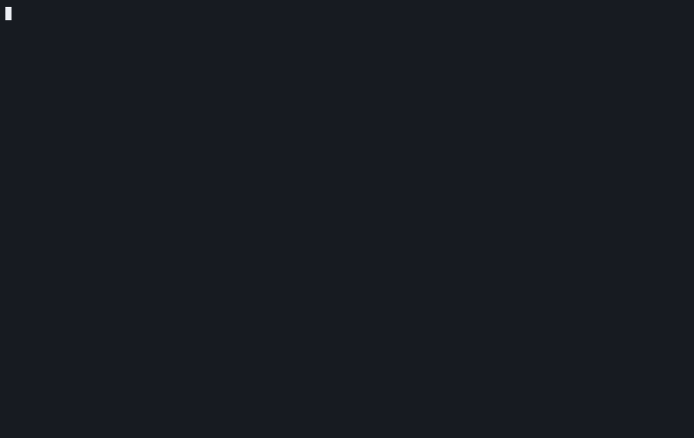

# workforce (`wf`)

<p align="center"></p>

Workforce (`wf`) coordinates coding agents working on a git repository across machines. 
You write down the work as **items**. A daemon on your machine starts **agents** (Claude Code, opencode, Codex, Gemini CLI) on them, each in its own clone of the repository, 
on the item's own branch. You answer their questions, review what they submit, and
approved work is merged into your target branch.

Everything that happens is an event in a signed log that every machine of yours keeps a copy of and
syncs peer to peer. There is no server and no account: wf runs from your terminal.

> [!WARNING]
> wf is in early, rapid development. Expect breaking changes between versions, including to the
> event log, the policy and the machine config.

## Install

You need Rust (stable), git 2.38 or later, [Fence](https://github.com/fencesandbox/fence) for the
sandbox agents run in, and at least one harness, logged in, with its ACP (Agent Client Protocol)
adapter on your `PATH`:

```sh
claude-agent-acp                 # Claude Code
opencode acp                     # opencode
codex-acp                        # Codex
gemini --experimental-acp        # Gemini CLI
```

Then build `wf`:

```sh
git clone <this repository> workforce && cd workforce
cargo install --path crates/wf-cli          # installs `wf` into ~/.cargo/bin
```

## Quick start

In the repository the agents should work on, create a workforce, define an agent that starts on
its own, and start the daemon:

```sh
cd ~/src/app
wf init --name app
wf agent add --harness claude-code --start auto
wf daemon start
```
```
created workforce "app" (vyxpmlnxamsk37bpvfy7x6ba52ck3vpkhwjn3dhtkarek5zkr7ka)
you are @ada
defined agent cecilia; this device runs it, `wf device edit --agent` changes that
the daemon runs (pid 48213); it logs to /Users/ada/.local/share/workforce/daemon.log
```

You are `@ada`, the **principal**: the person the agents work for. `wf init` writes
`.workforce.toml`; commit it, so that clones on your other machines find it. It also adds wf's own
repository as the remote `wf` of your checkout. The two follow each other: `wf` brings merged work
into your checkout, and sends your own commits on `main` to wf's repository before agents start from
it; when they diverge, it says what to run.

Add an item. The `- [ ]` lines are **steps** the agent ticks off and reports on:

```sh
wf item add --title "Parse durations in policy" --priority P1 --body "$(cat <<'EOF'
Accept `2h`, `30m` and `1h30m` wherever the policy takes a duration.

- [ ] Parse durations with humantime
- [ ] Error messages name the field
- [ ] Tests for both
EOF
)"
```
```
created #k3f7ab
 ITEM (TYPE:STATE)      PRIORITY  TITLE                      STEPS  BLOCKING
 ○ #k3f7ab (task:open)  P1        Parse durations in policy  0/3
```

Within seconds the daemon starts `cecilia` on it. Open the dashboard to follow along:

```sh
wf                               # what waits on you, who works on what; `?` lists the keys
```

The dashboard starts the daemon itself when none runs, so `wf` alone is enough to get going.

When the agent is done, it submits, and the review waits for you:

```sh
wf inbox
```
```
 WAITING           ITEM     TITLE                      WHAT
 principal_review  #k3f7ab  Parse durations in policy  review of 3e8a1c4f: `wf item diff`, then `wf review`
```

Look at the work, then approve it or send it back:

```sh
wf item show k3f7                # the item, its comments, the agent's reports
wf item diff k3f7                # the diff, in your pager

wf review k3f7 --approve         # merged into main as `Merge #k3f7ab: Parse durations in policy`

wf comment k3f7 "Name the field in the error." --request-change
wf review k3f7 --request-changes # back to the agent, on the same branch
```

All of this works in the dashboard too: `enter` on a session opens its live transcript, `c`
comments on an item, `D` opens the diff, `v` reviews.

## Everyday use

```sh
# What is going on
wf                               # the dashboard: keep it open next to your editor
wf inbox                         # blockers, reviews, merges, permission requests
wf status                        # a summary, and what to do next
wf log --follow                  # the events as they arrive; --item for one item

# Items
wf item list --ready             # what can be worked on now
wf item add --draft --title "…"  # held back until `wf item open`
wf item link k3f7 --depends-on x7k2      # k3f7 starts once x7k2 is done
wf comment k3f7 "Use PolicyError." --resolve q4tz    # answer a blocker

# Sessions
wf session watch k3f7            # the transcript of the item's latest session
wf session start k3f7 --agent cecilia   # start an agent by hand
wf session allow s4k2            # or deny: answer a permission request
```

Agents run in a sandbox and are allowed what they ask inside it by default. An agent with
`--permissions ask` holds each request for the deciders of your machine config, and then for you.

Every command explains itself (`wf <command> --help`), offers a picker at a terminal when you leave
out the item or session, and prints machine-readable output with `--json`.

## Agents, review and policy

```sh
wf agent add reviewer --harness codex --capability review    # an agent that can review
wf harness models claude-code                                # the models a harness offers
wf device edit --max-sessions 3 --agent cecilia=2            # what this machine runs
wf item add --title "…" --review light                       # reviewed by an agent, not by you
wf policy edit                   # item types, lanes, review and recovery levels, the merge target
```

Tasks are reviewed by you by default (`manual`). The other review levels hand the review to an agent
(`light`, `standard`), or to an agent and then you (`critical`). The policy is part of the log,
signed by you, so every machine follows it. What only one machine should do (the sandbox, the
agents' environment, notifications, commit signing) is in its machine config,
`~/.config/workforce/config.toml`, which is never synced.

## Several machines

Add your other machines, a desktop or a VM, so they sync the log and run agents too:

```sh
wf invite device                 # on a machine with your principal key; prints a wfi1... code
wf join wfi1... --name vm        # on the other machine, inside a clone of the repository
wf daemon start                  # on both: they find each other and sync
```

## Guides

- [items.md](docs/guide/items.md): states, steps, dependencies, comments, blockers, change requests
- [agents.md](docs/guide/agents.md): harnesses, defining agents, reviewers and supervisors, sessions
- [review-and-merge.md](docs/guide/review-and-merge.md): review levels, your review, the merge, recovery
- [dashboard.md](docs/guide/dashboard.md): the dashboard and its keys, `wf inbox`, `wf status`, `wf log`
- [machine-config.md](docs/guide/machine-config.md): sandbox, environment, storage, checks, signing, notifications
- [permissions.md](docs/guide/permissions.md): permission requests and their deciders
- [policy.md](docs/guide/policy.md): the policy and its defaults
- [machines.md](docs/guide/machines.md): several machines, the daemon as a service, keys, forks, backups

How wf works inside, and where it is going: [docs/SPEC.md](docs/SPEC.md).

## Working on wf

```sh
just check                                                  # formatting, clippy and all tests
PROPTEST_CASES=10000 cargo test --release -p wf-core        # the 10k-case property tests
cargo test --release -p wf-store -- --ignored --nocapture   # the 100k-event startup check
cargo test --release -p wf-net --test scale -- --ignored --nocapture   # a 100k-event join
cargo test -p wf-net --test simulation                      # 1,000 sync schedules, about a minute
```

## License
Workforce is licensed under [GPL-3.0-only](LICENSE).
